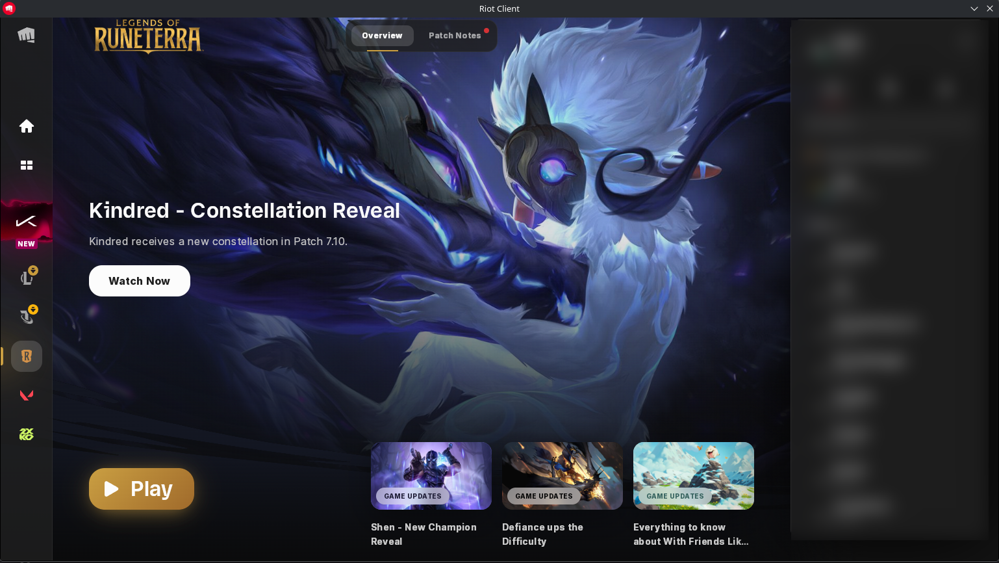
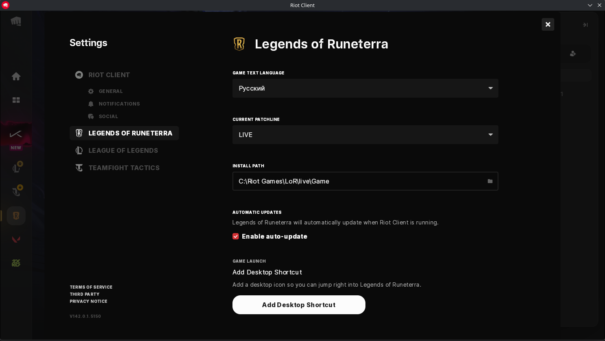
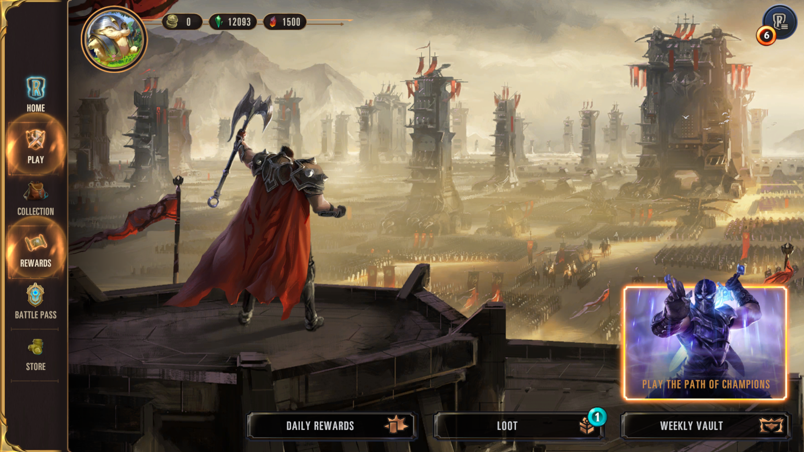

# Legends of Runeterra works on Linux again (Riot Client v142)

Since late October 2026 the Riot Client either loops on "Couldn't update" or shows no window on GE-Proton 9-27, and LoR itself crashes on newer Proton. I patched GE-Proton 9-27 (five rebuilt Wine DLLs, nothing else changed): the client updates itself again and the new v142 client runs. Tested in Bottles; Heroic, Lutris, Steam and umu instructions are below. Unofficial, not affiliated with Riot Games, GloriousEggroll or Valve. Feedback from other setups is welcome in the issues.

**Download:** [latest release](../../releases/latest) – `GE-Proton9-27-LoR1.tar.gz` and `GE-Proton9-27-LoR1.sha512sum`.

Tested on 2026-10-28: Riot Client 142.0.1.5150 updates itself, opens normally, and LoR starts (Bottles 67 Flatpak, umu library game, AMD GPU with RADV). The other launchers below have not been tested yet.

## Contents

- [Screenshots](#screenshots)
- [Install](#install)
  - [1. Download and verify](#1-download-and-verify)
  - [2. Extract it where your launcher looks for Proton](#2-extract-it-where-your-launcher-looks-for-proton)
  - [3. Select it for Legends of Runeterra](#3-select-it-for-legends-of-runeterra)
    - [Bottles 67](#bottles-67-tested)
    - [Heroic Games Launcher](#heroic-games-launcher-untested)
    - [Lutris](#lutris-untested)
    - [Steam, as a non-Steam game](#steam-as-a-non-steam-game-untested)
    - [umu-run](#umu-run-command-line)
  - [4. What to expect on the first start](#4-what-to-expect-on-the-first-start)
- [The problems it fixes](#the-problems-it-fixes)
- [What the patches change](#what-the-patches-change)
- [Build from source](#build-from-source)
- [When Riot ships the next client](#when-riot-ships-the-next-client)
- [Fallback without this runner](#fallback-without-this-runner)
- [Limits](#limits)
- [Credits](#credits)
- [License](#license)

## Screenshots

Riot Client v142 and Legends of Runeterra running on `GE-Proton9-27-LoR1` (click for full size):

| Riot Client v142 | Client settings (v142.0.1.5150) | Legends of Runeterra |
|---|---|---|
| <a href="docs/screenshots/1-riot-client-v142.png"></a> | <a href="docs/screenshots/2-riot-client-v142-settings.png"></a> | <a href="docs/screenshots/3-legends-of-runeterra-running.png"></a> |

## Install

### 1. Download and verify

Download both files from the [latest release](../../releases/latest) into `~/Downloads`, then:

```bash
cd ~/Downloads
sha512sum -c GE-Proton9-27-LoR1.sha512sum
```

It must print `GE-Proton9-27-LoR1.tar.gz: OK`.

### 2. Extract it where your launcher looks for Proton

| Launcher | Folder |
|---|---|
| Bottles (Flatpak) | `~/.var/app/com.usebottles.bottles/data/bottles/runners/` |
| Heroic (Flatpak) | `~/.var/app/com.heroicgameslauncher.hgl/config/heroic/tools/proton/` |
| Heroic (native) | `~/.config/heroic/tools/proton/` |
| Lutris | `~/.local/share/Steam/compatibilitytools.d/` (where recent Lutris versions look for Proton builds; untested) |
| Steam (native) | `~/.steam/root/compatibilitytools.d/` |
| Steam (Flatpak) | `~/.var/app/com.valvesoftware.Steam/data/Steam/compatibilitytools.d/` |
| umu-run | anywhere, e.g. `~/.local/share/proton/` |

```bash
mkdir -p <folder>
tar -xzf ~/Downloads/GE-Proton9-27-LoR1.tar.gz -C <folder>
```

This creates `<folder>/GE-Proton9-27-LoR1`. Restart the launcher afterwards so it picks the new version up. Bottles 67 also lists Proton builds from Steam's `compatibilitytools.d`, so one copy there can serve both.

### 3. Select it for Legends of Runeterra

You need the official installer, `Legends_Of_Runeterra_Installer.exe`, from playruneterra.com. Inside the prefix the game ends up at `C:\Riot Games\LoR\live\Game\LoR.exe`.

#### Bottles 67 (tested)

Already installed LoR as a library game:

1. Open **Library**, click **⋮** (More Actions) on the Legends of Runeterra card, then **Game Settings**.
2. Under **Proton**, click **Choose Proton** and pick `GE-Proton9-27-LoR1`.
3. Click **Save** and launch the game.

New install:

1. Open **Library**, click **+**: **Add a Windows Game**.
2. **Action**: **Run an Installer**, **Installer**: `Legends_Of_Runeterra_Installer.exe`.
3. Under **Compatibility**, **Proton**: **Choose Proton**, pick `GE-Proton9-27-LoR1`.
4. Click **Install** and go through the Riot installer. When it finishes, close the Riot Client.
5. Bottles asks for the game executable: choose `drive_c/Riot Games/LoR/live/Game/LoR.exe` inside the game's prefix.

#### Heroic Games Launcher (untested)

1. **Add Game** (in the library), platform **Windows**.
2. **Wine Version**: `GE-Proton9-27-LoR1`.
3. Enable **Run installer first** and choose `Legends_Of_Runeterra_Installer.exe`, then go through the Riot installer.
4. As executable, choose `drive_c/Riot Games/LoR/live/Game/LoR.exe` inside the prefix Heroic created (shown in the game's settings, by default under `~/Games/Heroic/Prefixes/`).

For an existing Heroic entry, open the game's settings and change **Wine Version** to `GE-Proton9-27-LoR1`.

#### Lutris (untested)

1. **+** → **Add locally installed game**, **Runner**: **Wine**.
2. **Game options**: executable `Legends_Of_Runeterra_Installer.exe` for now, **Wine prefix**: a new folder, e.g. `~/Games/legends-of-runeterra`.
3. **Runner options**, **Wine version**: `GE-Proton9-27-LoR1`. Save and launch, go through the Riot installer.
4. Edit the game again and change the executable to `drive_c/Riot Games/LoR/live/Game/LoR.exe` inside that prefix.

#### Steam, as a non-Steam game (untested)

1. **Games** → **Add a Non-Steam Game to My Library**, browse to `Legends_Of_Runeterra_Installer.exe`.
2. In the shortcut's **Properties** → **Compatibility**, enable **Force the use of a specific Steam Play compatibility tool** and pick `GE-Proton9-27-LoR1`.
3. Press **Play** to run the Riot installer.
4. In **Properties** → **Shortcut**, change **Target** to `LoR.exe` inside `steamapps/compatdata/<shortcut id>/pfx/drive_c/Riot Games/LoR/live/Game/` and **Start in** to that folder.

#### umu-run (command line)

```bash
export WINEPREFIX="$HOME/Games/legends-of-runeterra"
export PROTONPATH="$HOME/.local/share/proton/GE-Proton9-27-LoR1"
export GAMEID=umu-default

umu-run ~/Downloads/Legends_Of_Runeterra_Installer.exe
umu-run "$WINEPREFIX/drive_c/Riot Games/LoR/live/Game/LoR.exe"
```

The first command installs, the second starts the game.

### 4. What to expect on the first start

- Proton logs `Upgrading prefix from GE-Proton9-27 to GE-Proton9-27-LoR1` and copies the patched DLLs into the prefix. Switching back to GE-Proton9-27 copies the originals back.
- If your Riot Client is outdated, it shows a short update splash, updates itself and restarts. That is the part that used to fail with "Couldn't update".
- The Riot Client window opens. Its version is shown at the bottom left of **Settings** (`V142.0.1.5150` or newer).

**Still stuck on "Couldn't update"?** If you used the older workaround that keeps Riot Client v141, it wrote the newest release ID into `Riot Client.ok`. Delete `drive_c/ProgramData/Riot Games/Metadata/Riot Client/Riot Client.ok` so the launcher updates itself.

**Game in English?** Running the Riot installer again resets the game language to English. Change it in the Riot Client: profile icon → **Settings** → **Legends of Runeterra** → **Game text language**.

## The problems it fixes

### 1. "Couldn't update" on every Riot Client release

The Riot Client updates itself every few weeks. Under Wine the update always failed:

```
ERROR| Update failed: Failed getting path to current executable: File path could not be found in a mapped drive: \??\C:\Riot Games\Riot Client\RiotClientServices.exe
```

Windows returns mapped file names as `\Device\HarddiskVolumeN\...`, which the updater matches against `QueryDosDevice`. Wine returns `\??\C:\...`, so the match fails ([Wine bug 51687](https://bugs.winehq.org/show_bug.cgi?id=51687), open since 2021). The failed attempt also deletes `Riot Client.ok`, so the error comes back on every launch until you reinstall.

### 2. Riot Client v142 shows no window

Riot Client v142 (release `626519AF431D7214`, about 2026-10-26) moved from Electron 22 to Electron 43 (Chromium 150). Its window crashes on start with exit code `2147483651`; the crash dump says `DelayLoad-ModuleName = USER32.dll`, `DelayLoad-LastError = 127`. The new client loads functions that the Wine in GE-Proton 9-27 does not have. A fresh install gets the same client, so reinstalling no longer helps.

## What the patches change

| Patch | DLL | Change |
|---|---|---|
| `0001` | `user32` | Adds `GetPointerDevice`, `GetPointerPenInfo` (pen and touch input) and `IsWindowArranged` (window snapping state). They report "not available" / "not arranged". |
| `0002` | `uiautomationcore` | Adds `UiaDisconnectAllProviders` (accessibility clean-up), which reports success. |
| `0003` | `combase`, `ole32` | Replaces the crashing `RoGetAgileReference` stub with one that returns `E_NOTIMPL`, and exports it from `ole32` too. |
| `0004` | `kernelbase` | `GetMappedFileNameW` returns `\Device\HarddiskVolumeN\...` like Windows does. Fixes problem 1. |

Only these five DLLs are rebuilt, from the exact Wine source of GE-Proton 9-27 with all of GE's patches applied. Every other file of the runner is the original GE-Proton 9-27.

## Build from source

Requirements: Docker, git, curl, about 4 GB of free disk space and a network connection. Nothing is installed on the host; compiling happens in a Debian container with the MinGW cross compiler.

```bash
./build.sh                                   # downloads GE-Proton9-27 and verifies its checksum
./build.sh --base /path/to/GE-Proton9-27     # or reuses an existing GE-Proton9-27 folder
```

Results land in `dist/`: the runner folder, `GE-Proton9-27-LoR1.tar.gz` and its `.sha512sum`. Logs are in `build/prepare.log` and `build/build-dlls.log`.

The steps:

1. `scripts/prepare-wine.sh` clones `proton-ge-custom` at tag `GE-Proton9-27`, fetches its `wine` and `wine-staging` submodules, runs the Wine part of GE's `patches/protonprep-valve-staging.sh` unchanged, then applies `patches/*.patch`.
2. `scripts/build-dlls.sh` regenerates Wine's build files the way GE's build does, configures a 64-bit MinGW build and compiles only the five DLLs.
3. `build.sh` copies GE-Proton9-27, replaces the five DLLs in `files/lib64/wine/x86_64-windows`, renames the runner (`CURRENT_PREFIX_VERSION`, `version`, `compatibilitytool.vdf`) and packs it.

GE's own patch for Vanguard: Saga of Heroes passes a wide string to `GetEnvironmentVariableA`. GE's older compiler only warned about it; GCC 14 treats it as an error, so the build turns `incompatible-pointer-types`, `int-conversion` and `implicit-function-declaration` back into warnings. The affected code is compiled the same way as in GE's release.

## When Riot ships the next client

`tools/check-imports.py` lists every function the Riot Client loads that a runner does not provide:

```bash
tools/check-imports.py "<prefix>/drive_c/Riot Games/Riot Client" /path/to/GE-Proton9-27-LoR1
```

Output for client 142.0.1.5150 on this runner:

```
riot client.exe     delay  ADVAPI32.dll       AddConditionalAce
riot client.exe     delay  USERENV.dll        DeriveAppContainerSidFromAppContainerName
riotgamesapi.dll    delay  ACLSDK.dll         <whole DLL missing>
riotgamesapi.dll    delay  GCloudVoice.dll    <whole DLL missing>
```

These four are also missing in GE-Proton 11, where the client works, so they are never called (Chromium sandbox functions and China-only voice SDKs). Anything new in that list is a candidate for the next patch. A `delay` import only crashes when it is first called; a missing normal `import` stops the program from starting at all.

## Fallback without this runner

`scripts/lor-fix-client` keeps an old Riot Client v141 (Electron 22) and marks it as the newest release so the launcher skips updating. It needs a backup of a v141 install and stops working once Riot's servers reject v141. It is configured with the environment variables `LOR_PREFIX`, `LOR_CLIENT_BACKUP` and `LOR_WINE_USER`; [docs/riot-client-v141-workaround.md](docs/riot-client-v141-workaround.md) explains how to make the backup and use it.

## Limits

- The added functions are placeholders. If a future Riot Client actually depends on pen input, window snapping information or agile references, it needs real implementations.
- LoR itself crashed on GE-Proton 11-11 in a single test. Other Proton 10.x and 11.x builds were not tested.
- Riot can change the client again at any time; `tools/check-imports.py` shows quickly whether a runner still covers it.

## Credits

- [GloriousEggroll](https://github.com/GloriousEggroll/proton-ge-custom) for GE-Proton, [Valve](https://github.com/ValveSoftware/Proton) for Proton, the [Wine](https://www.winehq.org/) and [wine-staging](https://gitlab.winehq.org/wine/wine-staging) projects.
- Matías Zúñiga for tracking down Wine bug 51687 in 2021.

## License

The patches in `patches/` modify Wine and are licensed under the GNU LGPL 2.1 or later, like Wine itself. The released runner is GE-Proton 9-27 with five rebuilt DLLs; its source is GE-Proton 9-27 (`proton-ge-custom` tag `GE-Proton9-27`) plus the patches in this repository.
